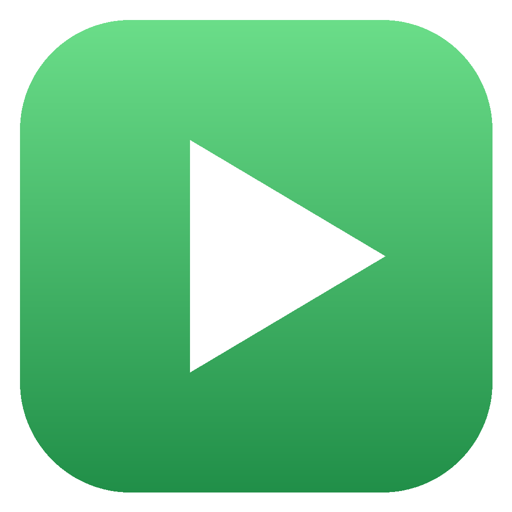
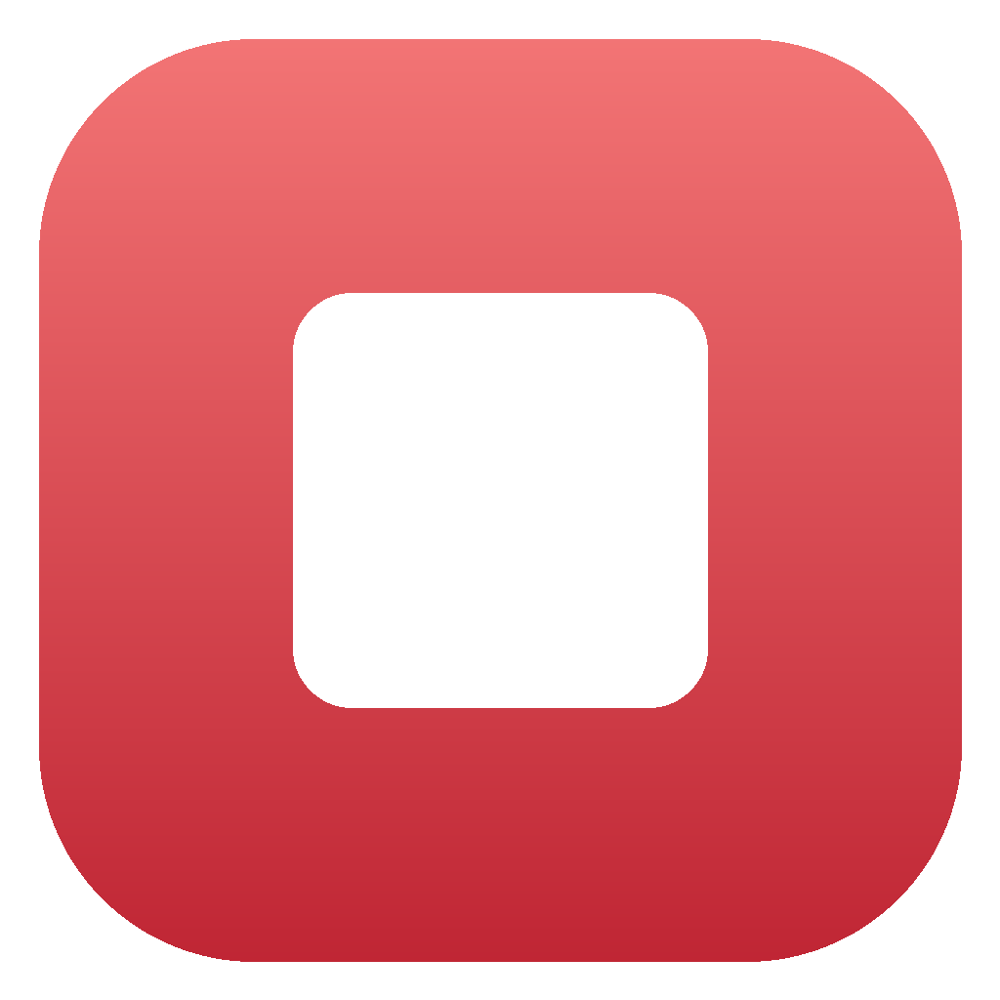
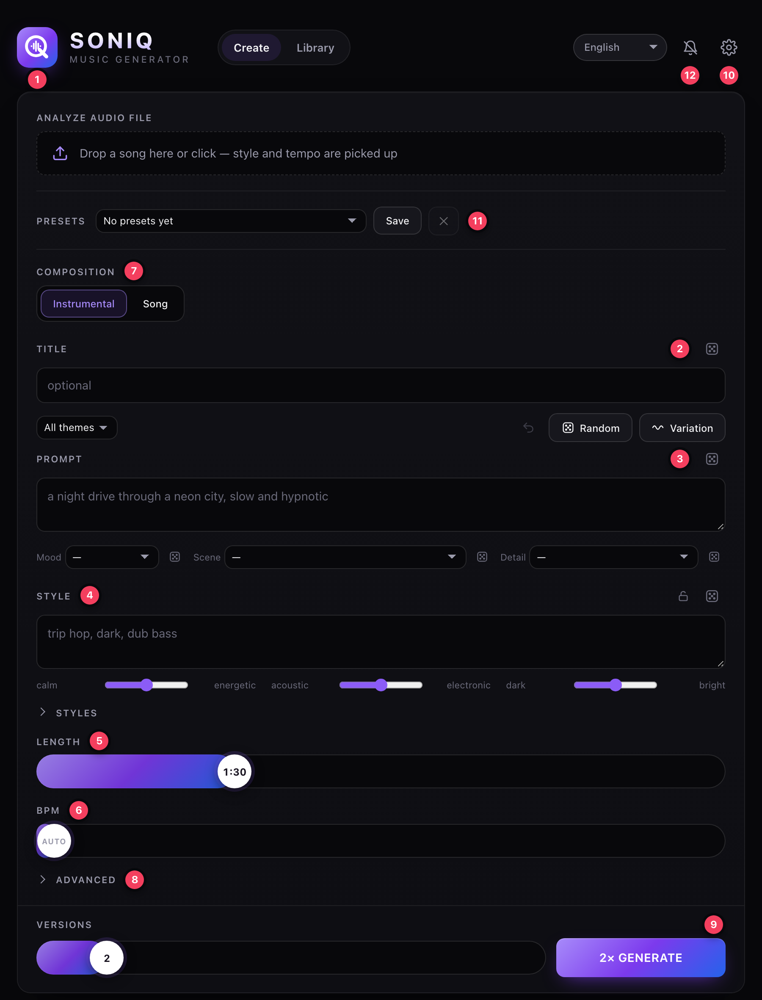
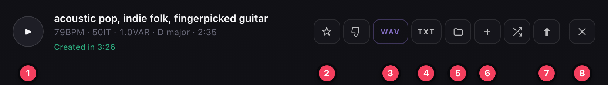
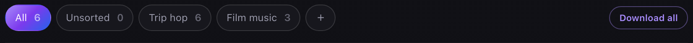

# Using the app

[← Guide](README.md) · Next: [Help](troubleshooting.md)

## Start and stop

| | |
|---|---|
|  **Music Generator ON** | starts everything and opens the app in the browser |
|  **Music Generator OFF** | stops everything and closes the browser tabs |

Both are in the project folder, on Windows also on the desktop. Mac tip: drag them to the Dock.
The app runs at **http://localhost:8765**, the windows close by themselves after starting.
You can also stop the servers from inside the app: **Gear › Stop servers**.

## The screen

| # | Element | What it does |
|---|---|---|
| 1 | **Analyze audio file** | Upload field at the top of the form: drop a song on it or click it. The app analyzes it and fills in prompt, tempo and length. Works with WAV, MP3, M4A, FLAC and OGG. |
| 2 | **Title** | Only for finding the song again. The dice suggests a name. |
| 3 | **Prompt** | Your idea: mood, scene, sound. The dice rolls an idea. |
| 4 | **Style** | Genre and instruments. Dice: a suggestion. Under “Styles”, cards add terms. |
| 5 | **Length** | 10 seconds to 5 minutes, default 1:30. |
| 6 | **BPM** | Tempo. Far left = Auto, the model decides. |
| 7 | **Vocals** | Right below the upload field: switch between **Instrumental** and **Song**. With Song: pick the language and type your own lyrics, or leave the field empty (dice: “Automatic”) and the model writes its own lyrics when generating. |
| 8 | **Advanced** | Iterations (quality), variance (variety), key, time signature, seed. |
| 9 | **Generate** | Pick the number of versions (1 to 10) and go. Several versions are named A, B, C … The bar stays visible while scrolling. |
| 10 | **Gear** | Settings, see [below](#settings). Next to it: interface language (twelve languages, from German to Chinese). |

Above the prompt sit three more buttons:

- **Random** rolls prompt and style together.
- **Variation** changes them only slightly: one building block of the prompt (mood, scene, detail) or one style term is swapped, or a term is added. Your own text stays.
- **↶** takes back the last roll, step by step.

The **lock** next to the prompt and style dice keeps that field as it is: Random and Variation then only change the other one.

The **theme** picker left of these buttons keeps the dice inside one world: Film score, Club, Lo-fi, 80s, Acoustic, Ambient or Hip-hop (or All).

Below the prompt, **Mood**, **Scene** and **Detail** show the building blocks of the prompt. Pick one from the list or roll just that one with its dice; the rest of the prompt stays.

After analyzing a song, **Similar but different** appears under the upload field. Each click keeps tempo, key, length and description of the analyzed song and rolls a new style.

## Keyboard shortcuts

They work as long as the cursor is not in a text field (except Ctrl/⌘ + Enter).

| Key | Action |
|---|---|
| **R** | Random: roll prompt and style |
| **V** | Variation |
| **U** | Undo the last roll |
| **Ctrl/⌘ + Enter** | Generate, also while typing |
| **Space** | Play / pause (starts the first song if nothing is playing) |
| **J / K** | Next / previous song |

## A song in the library

| # | Button | What it does |
|---|---|---|
| 1 | **Play** | play, with waveform in the player at the bottom |
| 2 | **Star** | mark as favorite |
| 3 | **WAV / MP3** | download the song |
| 4 | **TXT** | show the lyrics the model wrote (only for songs with vocals) |
| 5 | **Folder** | move to a folder |
| 6 | **Plus** | another version with a new seed |
| 7 | **Arrow** | copy the settings back into the form |
| 8 | **Cross** | delete, or cancel a running song |

Click a title to rename it. The line below shows **BPM · IT** (iterations) **· VAR** (variance) · key · length.
“Created in …” disappears once you play the song for the first time.

## Folders

Create a folder with **+**. Drag songs onto a folder, or move them with the folder button of the song row
(each version separately). Clicking a folder shows only its songs; new songs land in the folder that is currently open.
**Download all** or **Download folder** downloads the finished songs of the view as a ZIP.
Deleting a folder removes only the folder, not the songs.

## Settings

Open them with the **gear** at the top right.

| Setting | Meaning |
|---|---|
| **Synthesis server / Language model server** | Addresses of the model servers. The installer sets them, normally there's nothing to change. |
| **Timeout** | How long a song may take before it is aborted (minutes). |
| **Sound model** | Standard or, if installed, XL (better sound, about twice as slow). |
| **Output format** | File format of new songs: **WAV 16 bit** (default, lossless, plays everywhere), **WAV 24 bit** or **WAV 32 bit float** for further editing (larger files), **MP3** with 320, 192 or 128 kbit/s to save space. |
| **Song folder** | Where finished songs are stored, see below. |
| **Layout** | Generator and library stacked, or side by side (from about 1000 px window width). |
| **Version** | Check for updates and install them. |
| **Servers** | Stop the app and the model servers. |

## Where the songs are

Finished songs are stored in the subfolder `data/songs` of the program folder, i.e. `~/soniq/data/songs` on
the Mac or `C:\Users\<Name>\soniq\data\songs` on Windows. The file names are IDs; the titles live in the app.

To use a different place, go to **Gear › Song folder**, enter a full path and save. The app creates the folder and
moves the existing songs there. Leaving the field empty means back to default.

## Updating

In the app: **Gear › Check for updates › Update now**. The app fetches the new version from GitHub and restarts;
your songs are kept. If it reports a new installer version, run **Install** once afterwards.

---

Something not working? See [Help](troubleshooting.md).
